## Balloons Over Iowa

{: .badge-art}

> This analyst completed the "Balloons Over Iowa" module, investigating a phishing and ransomware attack. They identified command and control connections, detected data exfiltration, analyzed Mimikatz activity, and observed shadow copy deletions, demonstrating their ability to effectively respond to and analyze cyber threats.

- **earned:** March 22, 2024
- **issuer:** KC7 — the cyber detective game

[verify this achievement ↗](https://kc7cyber.com/badges/earned/963)

part of the [trophy shelf](/about/#achievements).
