## Envolve Labs

{: .badge-art}

> This analyst completed the "Envolve Labs" module. They demonstrated skills in using Kusto Query Language (KQL) in their investigation that included identifying phishing campaigns, analyzing command-line activities, and uncovering credential theft and data exfiltration. They also learned to cluster and attribute attacks to specific threat actors, connecting malicious domains and email addresses to threat actor behavior.

- **earned:** April 2, 2024
- **issuer:** KC7 — the cyber detective game

[verify this achievement ↗](https://kc7cyber.com/badges/earned/1033)

part of the [trophy shelf](/about/#achievements).
