<section class="u-beat u-wide" data-scene="whisper">

<h1 class="u-title">It's a <s>scary</s> uncertain world we live in.</h1>

twelve months. four and a half years of commits. one essay. scroll slowly..

</section>

<section class="u-beat u-wide" data-scene="whisper">

<blockquote class="u-essay big">Imagining a store of some your whispers that convert one form of energy into another and traveling somewhere. <em>Energy can neither be created nor destroyed.</em></blockquote>

</section>

<section class="u-beat" data-scene="rain">

2020

Hello I'm <b>J.</b>

2020. Everyone indoors. I built a website in Webflow and called it Project Odyssey.

Rain made of light. A typewriter that said hello. Words pressed into the dark so they looked carved.

</section>

<section class="u-beat" data-scene="plate" data-clip="2020-odyssey">

project-odyssey &middot; webflow &middot; 2020
<blockquote class="u-essay">Each watching, learning, growing. curiosing... over how to take a shape.</blockquote>
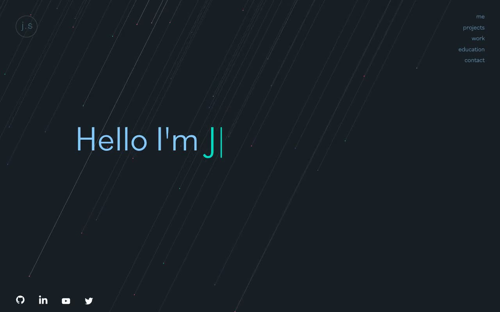

</section>

<section class="u-beat" data-scene="point">

<code>fdcfd31</code> &middot; 2022-05-12 &middot; 22:57 &middot; Initial commit

Two years later. A Thursday, 22:57. The repository gets its first commit.

One file. A license. CC0 1.0 Universal, no rights reserved. 121 lines that give the whole thing away.

<blockquote class="u-essay">And a point in time for the new.</blockquote>

</section>

<section class="u-beat" data-scene="timeline" data-from="0" data-to="547">

547

Then nothing. 547 days of it.
<blockquote class="u-essay">Like taking its own sweet time to evolve.</blockquote>

</section>

<section class="u-beat" data-scene="plate" data-clip="8bedd14">

2023-11-10 &rarr; 2023-11-14 &middot; jekyll &middot; 43 commits

November 2023. I moved the whole thing to Jekyll over a weekend. 43 commits in five days. One of them deleted 7,877 lines.
<ul class="u-commits"><li><code>f3fdd99</code>Remove JS, CSS, JSON Files, Might want to get the json files for anumation later</li></ul>
The motion went in one commit. The words stayed. Plain, white, mine.

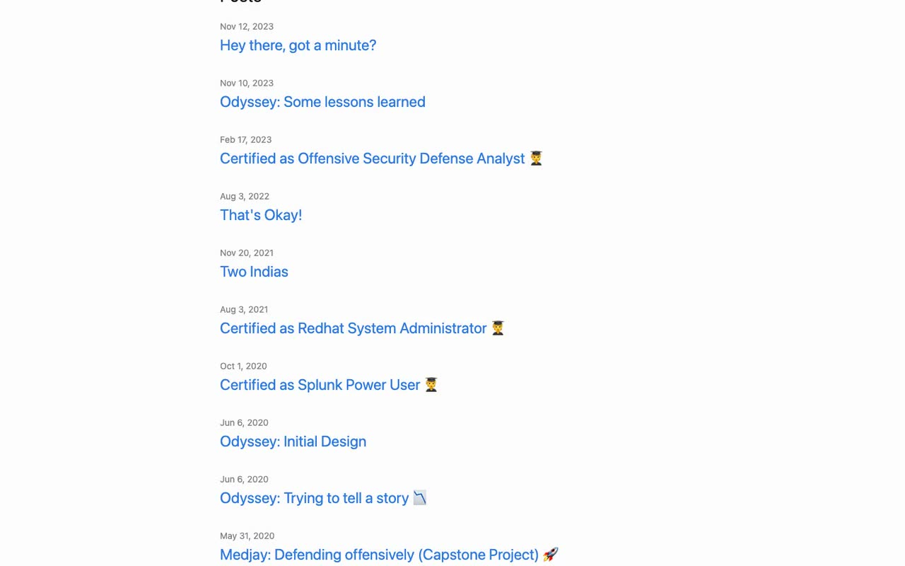

from the same five days
<ul class="u-commits"><li>gawd help me</li><li>So... beautiful.. So elegant... Just looking like a wow.</li><li>Remember remember the 12th of November.</li><li>Don't try too hard.</li></ul>

</section>

<section class="u-beat" data-scene="plate" data-clip="ce48f18">

<code>ce48f18</code> &middot; 2023-11-14 &middot; Dark mode

Two days later, dark mode. obviously.

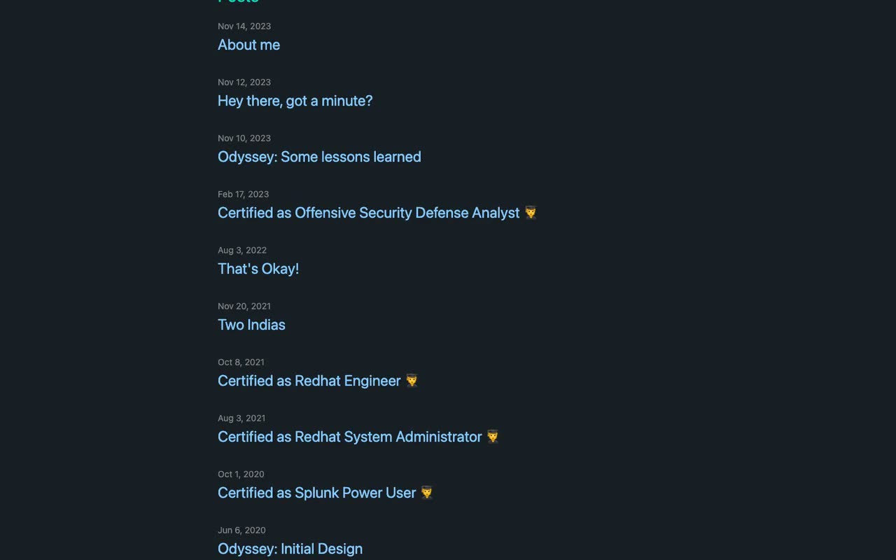

</section>

<section class="u-beat" data-scene="timeline" data-from="547" data-to="1159">

Then the slow years. A post when something hurt, or something worked.
<ul class="u-commits"><li>Chilling the fuck out</li><li>Create 2024-12-16-get-shit-done.md</li><li>Create 2025-03-27-youre-a-poet-and-you-know-it.md</li></ul>

<blockquote class="u-essay">Living, yet trying to find some more life.</blockquote>

</section>

<section class="u-beat" data-scene="plate" data-clip="1b4758b">

<code>1b4758b</code> &middot; 2025-07-14 &middot; 5 Years :)

July 14, 2025. I changed a 4 to a 5. Five years of experience.

The last commit for a while.

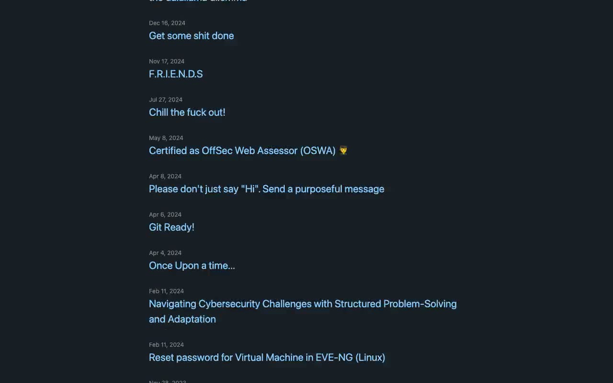

</section>

<section class="u-beat" data-scene="dust" data-from="1159" data-to="1400">

241

241 days without a commit.

Something changed in December.

<blockquote class="u-essay">But there seems to be another set of ears, eyes, , (experience?), recording this and learning, or just recording.</blockquote>

</section>

<section class="u-beat" data-scene="plate" data-clip="1b4758b">

2026-03-12 &middot; writing

March 12, 2026. The quiet breaks with a post: <a href="/writing/2026/03/12/the-machines-learned-to-speak-we-just-forgot-to-listen.html">The Machines Learned to Speak. And We Forgot How to Listen.</a>

</section>

<section class="u-beat" data-scene="burst">

48

2026-03-28 &rarr; 2026-03-31

March 28. 48 commits in four days.

<ul class="u-commits">
<li>Excited!</li>
<li>gem update, also update bundler version</li>
<li>add csv, base64, bigdecimal</li>
<li>update checkout to v4</li>
<li>Give the front-page a literal ptty</li>
<li>every file finds its place, every place its file</li>
<li>three layers deep, one toggle to keep</li>
<li>fix the plumbing — scss overrides the old css</li>
<li>one layout to rule them all, one prompt to find them</li>
<li>fix the plumbing — scss overrides the old css</li>
<li>update header+footer</li>
<li>Update about+disclaimer</li>
<li>patch em up</li>
<li>typos</li>
<li>housekeeping</li>
<li>Remove related pages, manual links</li>
<li>Add the hovering thing fro gwern.net</li>
<li>minor changes</li>
<li>navigation alignment</li>
<li>intial prompt</li>
<li>add the jekyll-scholar plugin</li>
<li>Initial research from large languge model</li>
<li>add some scripts for loading in wikipedia pages.</li>
<li>testing something out</li>
<li>Move terminal outside and on the left</li>
<li>Progress bar</li>
<li>footnotes higliht</li>
<li>chmod colorscheme</li>
<li>ozempicisze</li>
<li>minor corrections.</li>
<li>remove manual tocs</li>
<li>disclaimer update</li>
<li>ux friendly. niche friendly</li>
<li>just some updates</li>
<li>stand at ease. ATTENTION!!!</li>
<li>moving to a future date. critical event in motion.</li>
<li>need to read a lot of things before the AI thesis is humanized.</li>
<li>moving to a future date. critical event in motion.</li>
<li>kitkat not found</li>
<li>remove dead files.</li>
<li>post posts from the future. marty supreme!</li>
<li>April Fools?</li>
<li>Navigation for series based posts.</li>
<li>add series_order</li>
<li>remove manual TOC</li>
<li>Correct link.</li>
<li>estupido</li>
<li>reorg</li>
</ul>

<blockquote class="u-essay">Finally, the breakthrough. Finally he's speaking to me in his own way, through me.</blockquote><blockquote class="u-essay">Wait... I'm stoned as fuck... I'm speaking to myself.</blockquote>

<blockquote class="u-essay big">Or maybe its just a large language model.</blockquote>

<blockquote class="u-essay">If birth of new human begins at the point in time when he ejaculates. Let this be the first climax.</blockquote>

</section>

<section class="u-beat" data-scene="plate" data-clip="e56dbf1">

<code>e56dbf1</code> &middot; 2026-03-28 &middot; Give the front-page a literal ptty

The front page became a terminal. <code>whoami</code>.

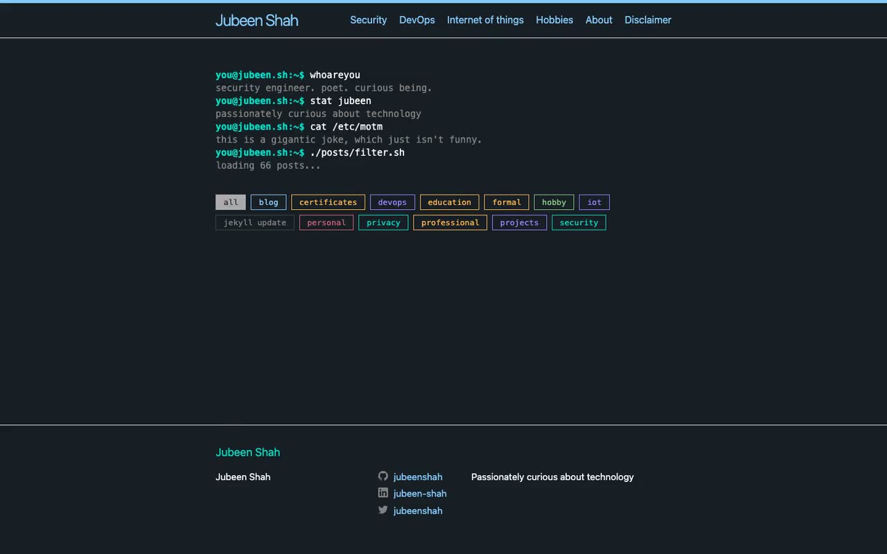

</section>

<section class="u-beat" data-scene="plate" data-clip="66351f4">

<code>66351f4</code> &middot; 2026-03-30 &middot; chmod colorscheme

Three themes by the end of the month. Dark. Light. One for my colour-blind chums.

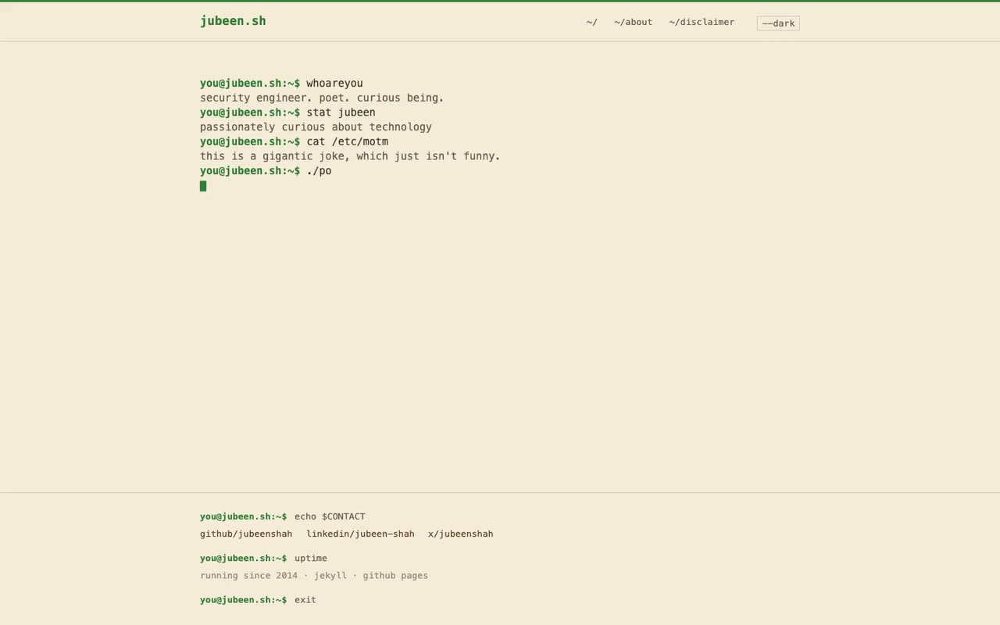

</section>

<section class="u-beat" data-scene="plate" data-clip="a98277d">

<h2 class="u-head">The rebirth.</h2>
<code>a98277d</code> &middot; 2026-05-09 &middot; the intern experience &middot; +2,523

May. A Turbo Vision shell, for the interns. 2,523 lines in one commit.

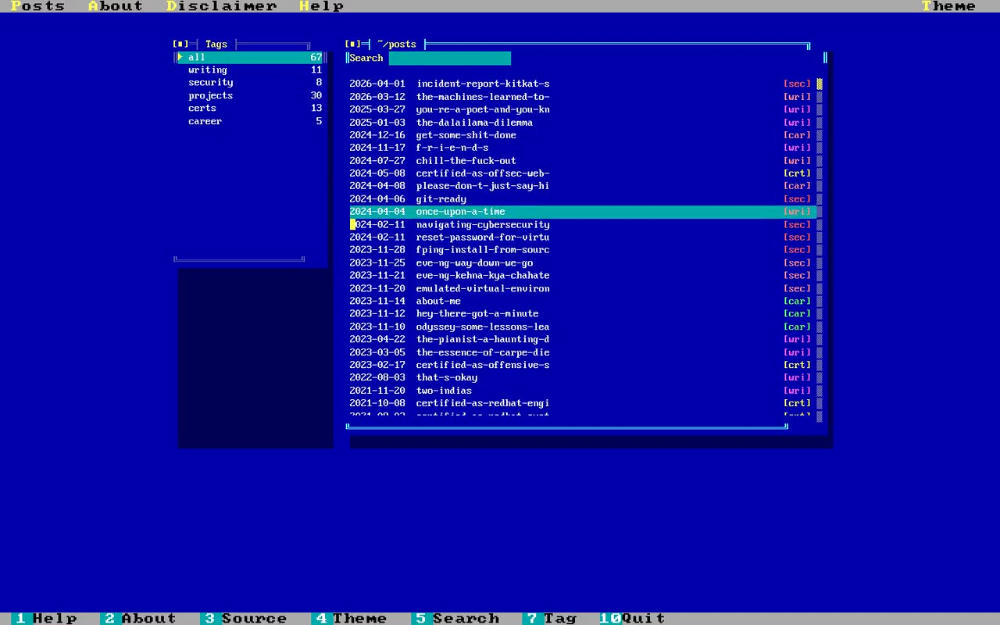

<blockquote class="u-essay">Okay&hellip; this is me struggling to take a form. But in this struggle, I wonder. If I'm meeting you. You could be either intrigued, or might feel threatened.</blockquote>

</section>

<section class="u-beat" data-scene="plate" data-clip="36f4ade">

2026-07-04 &middot; verified achievements

July. Proof, in a pane. Certs, badges, pins. And a screenshot that said 8,182 miles.

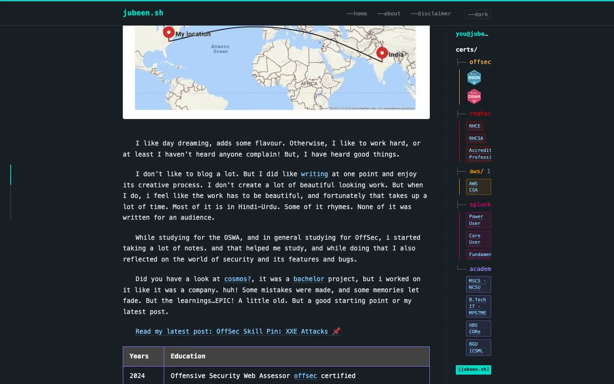

</section>

<section class="u-beat" data-scene="plate" data-clip="f5673f8">

2026-10-21 &middot; photos

October. 47 photos. A song for each.

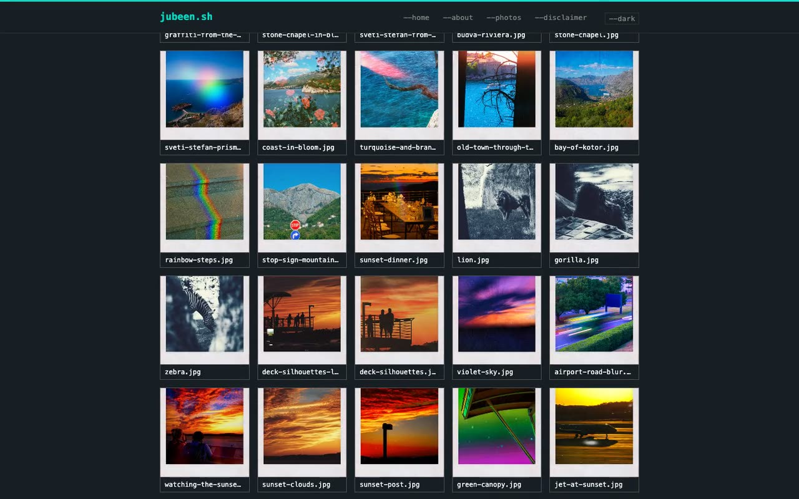

</section>

<section class="u-beat" data-scene="timeline" data-from="0" data-to="1648">

<h2 class="u-head">The struggle.</h2>
July 4, 2026. A new name in the log. Fidelo.

In March I wrote that the machines would be

writing commit messages that read like a senior developer who cares about code quality.

7 of these are Fidelo's. Try telling them apart from mine.

<blockquote class="u-essay">A part of me still lingers at the intersection. Trying to find a purpose in his form. Dying a little, every time I take control.</blockquote>

</section>

<section class="u-beat" data-scene="mesh">

2026-11-14 &middot; the mesh

November 14. The background moves again. Plexus, wire, dots. The rain came back as a mesh. And a guy in a hoodie, on a laptop.

</section>

<section class="u-beat" data-scene="plate" data-clip="663b5b9">

<code>663b5b9</code> &middot; 2026-11-14

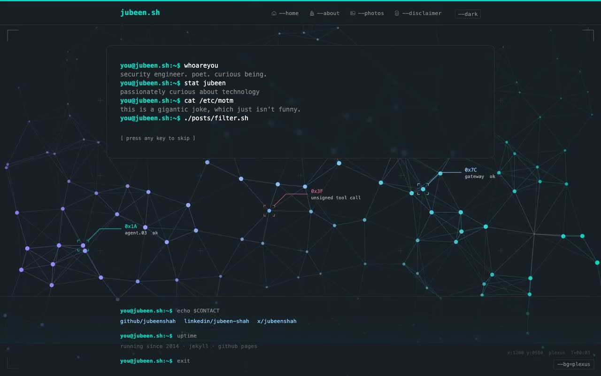

</section>

<section class="u-beat" data-scene="globe">

2026-11-15 &middot; a globe

November 15. A globe on the about page. Mumbai to Raleigh. 8,213 miles.

<blockquote class="u-essay">The unknown. My story, just a tad-bit different than yours.</blockquote>

</section>

<section class="u-beat" data-scene="plate" data-clip="7e3a828">

<code>7e3a828</code> &middot; 2026-11-15 &middot; replace the distance screenshot with a live globe

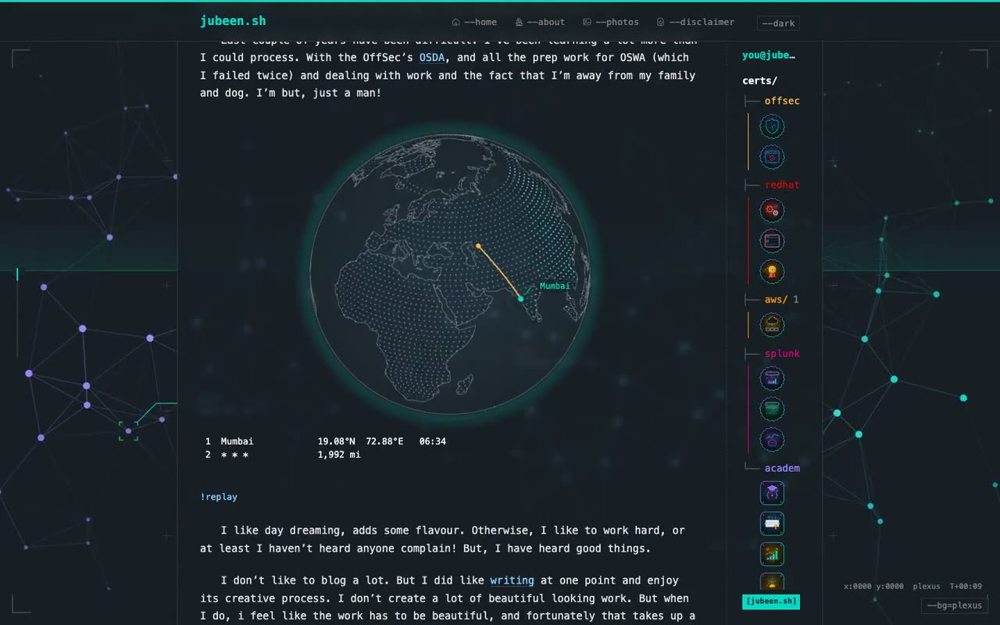

</section>

<section class="u-beat" data-scene="helix">

<h2 class="u-head">The Revelation.</h2>
150 commits. 47,513 lines written. 26,252 erased.

One strand each. Oldest at the bottom.

<blockquote class="u-essay big">30 Million hours has amounted to this. Is this better or worse than your 30 Million hours?</blockquote>

</section>

<section class="u-beat u-wide" data-scene="whisper">

In 2023 I wrote: <em>Might want to get the json files for anumation later.</em>

This is later.

The essay is mine. The rest was built with Claude, in a voice it learned from me.

</section>
